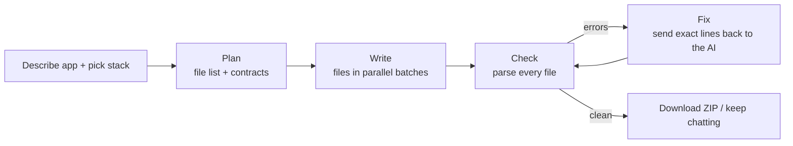

# AutoScript Agent

[](https://github.com/soumyakant1211/autoscript-agent-free/actions/workflows/ci.yml)

**Live:** https://autoscript-agent.onrender.com

Describe the app you want to test and get a complete, runnable **test automation framework** — for **54 stacks** (Selenium, Playwright, Cypress, Appium, RestAssured, Karate, Robot Framework, k6, JMeter, OWASP ZAP, low-code tools and more). The agent plans the project, writes every file, **syntax-checks all of it and fixes what's broken** before you see it. Sign-in, roles, quotas, saved history and an admin panel included. Runs on free tiers.

> **Reviewing this project?** Open the live link → **Use a demo account**. Each sign-in opens a *private copy* of the demo account (deleted after 24 hours), so you can try the generator or the read-only admin panel without seeing anyone else's work.

---

## How generation works



1. **Plan** — the AI returns a JSON plan: every file, its purpose, and the names other files rely on (e.g. `class LoginPage { login(user, pass) }`).
2. **Write** — files are generated in parallel batches against that plan, so big projects never get cut off.
3. **Check** — every file is parsed: Java, Python, C#, TypeScript, JavaScript (tree-sitter), JSON, YAML, XML/JMX/csproj, Gherkin `.feature`, and bracket-balance checks for Kotlin/Swift/Scala/Groovy. Missing build files (pom.xml, package.json…) are flagged.
4. **Fix** — anything broken goes back to the AI with the file and line; up to 2 rounds. The chat shows a **✓ N files syntax-checked** badge.
5. **Refine** — follow-up chat changes are checked and fixed the same way.

If Gemini is overloaded, the app retries, falls back to lighter Gemini models, then to Groq. Failed attempts never count against a user's limit.

## Roles & limits
| Account | How you get it | New frameworks | Follow-ups / project | History | Admin panel |
|---|---|---|---|---|---|
| **Guest (no sign-in)** | "Continue as guest" | 2 / month (per browser **and** per visitor IP) | 3 | — | — |
| **Guest** | Google / Microsoft / GitHub / email link | 5 / month | 5 | — | — |
| **Member** | An admin upgrades you | 50 / month | 30 | ✓ | — |
| **Demo Admin / Member / Guest** | Credentials shown on the sign-in page | 5 / day per visitor | by role | ✓ (member/admin) | Demo Admin: read-only, emails masked |
| **Admin** | `OWNER_EMAIL` login or an `ADMIN_EMAILS` address | Unlimited | Unlimited | ✓ | Full: roles, bans |

All limits and permissions are enforced on the server; Better Auth's own admin endpoints also reject non-admins.

## Tech stack
| Layer | Choice |
|---|---|
| App | **Next.js 16** (App Router, React 19, TypeScript), **Tailwind CSS v4** |
| Auth | **Better Auth** — Google, Microsoft, GitHub, email magic link, password (owner + demo), anonymous guests, admin roles, built-in sign-in rate limiting |
| Data | **PostgreSQL** (free on **Neon**) via **Drizzle ORM** + migrations |
| AI | Google **Gemini** (free) with fallbacks; **Groq**, OpenRouter, Ollama or Claude also supported |
| Code checks | **web-tree-sitter** grammars, `yaml`, `fast-xml-parser`, `@cucumber/gherkin` |
| Tests | **Vitest** (unit), **Playwright** (end-to-end, desktop + mobile) |
| Hosting / CI | **Render** (free), **GitHub Actions** |

## Tests
```
npm run test:unit     # 50 Vitest tests: syntax checker per language, plan parsing, quotas, IP handling, XSS-safe chat rendering
npm run test:e2e      # 21 Playwright tests against the production build with a mock AI (no quota used)
```
E2E covers: landing page (desktop + mobile, no horizontal scroll, social image), route protection, wrong password, owner admin, guest flow, **full generate → syntax error → auto-fix → ZIP download**, follow-up chat, guest monthly limit, demo credentials, **private demo copy per visitor**, demo history, and the **read-only demo admin** (UI and API).
Each E2E test runs as a different visitor (own IP), so per-visitor limits never leak between tests. CI runs type-check, lint, unit tests, migrations, build and E2E on every push, and uploads the Playwright report.

Locally E2E needs a migrated Postgres: `DATABASE_URL=… npm run db:migrate && npm run build && npm run test:e2e`.

---

## Deploy for free

### 1. Database — Neon
https://neon.com → new project (region **AWS Asia Pacific (Singapore)** is closest to India) → **Connect** → copy the connection string → `DATABASE_URL`.

### 2. AI key — Gemini (+ optional Groq backup)
https://aistudio.google.com/apikey → **Create API key** (keys starting with `AQ.` are fine). Optional backup: https://console.groq.com/keys → `GROQ_API_KEY`.

### 3. Render settings
Render → service → **Environment**:
| Key | Value |
|---|---|
| `DATABASE_URL` | from Neon |
| `BETTER_AUTH_SECRET` | random 40+ characters (Render's **Generate** button) |
| `GEMINI_API_KEY`, `AI_PROVIDER=gemini` | your key |
| `GROQ_API_KEY` | optional backup |
| `OWNER_EMAIL`, `OWNER_PASSWORD`, `OWNER_NAME` | **your private admin login** — never shown anywhere |
| `ADMIN_EMAILS` | emails that become Admin when they sign in with Google/Microsoft/GitHub/email link |
| `DEMO_LOGINS=1`, `DEMO_PASSWORD` | e.g. `Recruiter@2026` — **shown publicly** on the sign-in page |

**Settings → Build & Deploy:** Build `npm ci && npm run db:migrate && npm run build` · Start `npm start` · Health check `/api/health`.

### 4. One-time: GitHub workflow files
Copy the CI and keep-alive workflows into `.github/workflows/` (see `setup/README.md`):
```
mkdir .github\workflows 2>nul & copy /Y setup\github-workflows\*.yml .github\workflows\
```

### 4b. Push
`git add -A && git commit -m "…" && git push` — Render redeploys automatically.

### 5. Keep it awake (no 50-second cold start)
Render's free service sleeps after 15 idle minutes. Two free options — ping **`/api/ping`**, which deliberately doesn't touch the database (pinging `/api/health` would keep Neon awake 24/7 and use up its free compute hours):
- **UptimeRobot** (recommended): https://uptimerobot.com → *Add New Monitor* → HTTP(s) → URL `https://<your-app>/api/ping` → interval **5 minutes**.
- **GitHub Actions**: `.github/workflows/keep-alive.yml` pings every 10 minutes. Set repo variable `APP_URL` (Settings → Secrets and variables → Actions → Variables). GitHub pauses scheduled workflows after 60 days without commits.

Or upgrade the Render instance (paid) — always on, no pings needed.

### 6. Custom domain (optional)
1. Buy a domain (Namecheap, GoDaddy, Cloudflare, Hostinger…).
2. Render → service → **Settings → Custom Domains → Add** (e.g. `autoscript.yourname.dev`).
3. At your DNS provider: subdomain → **CNAME** to `autoscript-agent.onrender.com`; root domain → **ALIAS/ANAME** to it, or an **A** record `216.24.57.1`. Remove `AAAA` records.
4. Wait for Render to verify and issue the certificate.
5. Set `BETTER_AUTH_URL=https://your.domain` in Render, update the Google/Microsoft/GitHub redirect URIs and the `APP_URL` variable, then redeploy.

### 7. Google / Microsoft / GitHub sign-in
Callback URL for each: `https://<your-url>/api/auth/callback/<google|microsoft|github>`. Add the client ID/secret in Render and redeploy — the button activates automatically.
- **Google:** console.cloud.google.com → Google Auth Platform → Branding + Audience (External) → Clients → *Web application* → JavaScript origin `https://<your-url>`, redirect URI as above → `GOOGLE_CLIENT_ID/SECRET`. Publish the app or add test users.
- **Microsoft:** entra.microsoft.com → App registrations → New → *any organizational directory and personal accounts* → Web redirect URI → client ID + **Certificates & secrets** value → `MICROSOFT_CLIENT_ID/SECRET`, `MICROSOFT_TENANT_ID=common`.
- **GitHub:** Settings → Developer settings → OAuth Apps → New → callback URL → `GITHUB_CLIENT_ID/SECRET`.

### 8. Email links (optional) — Resend
`RESEND_API_KEY` from https://resend.com. The default sender only delivers to your own address; verify a domain to email anyone (`EMAIL_FROM=AutoScript Agent <login@yourdomain>`). Without Resend, links are printed to the server log.

---

## Design decisions
- **Plan → parallel write → check → fix** instead of one long answer: no truncated projects, files agree on shared names, and broken syntax is caught by real parsers rather than trusted.
- **Private demo copies:** signing in with the public demo credentials is intercepted in a Better Auth `before` hook that creates a temporary user with the same role. Visitors never share quota or history; copies are deleted after 24 hours; a per-visitor cap stops abuse.
- **Real client IP:** Render forwards client-supplied `X-Forwarded-For` values, so the app trusts Cloudflare's headers or counts proxy hops from the right instead of taking the (spoofable) first entry. IPs are stored only as salted hashes.
- **Quotas recorded before the AI call** (so parallel requests can't overspend) and **refunded** if nothing usable was produced.
- **Mock AI mode** makes the whole pipeline testable in CI with zero AI cost, including a deliberately broken file to exercise auto-fix.

## Run locally
```
cp .env.example .env.local      # DATABASE_URL, BETTER_AUTH_SECRET, GEMINI_API_KEY, OWNER_EMAIL/PASSWORD…
npm install
npm run db:migrate
npm run dev                     # http://localhost:3000   (MOCK_MODE=1 = no AI calls)
```

## Project layout
```
src/app/page.tsx              public landing page          src/app/app/      the generator (signed-in)
src/app/login, history, admin sign-in, saved projects, admin panel
src/app/api/generate          streaming generation + quota checks
src/lib/pipeline.ts           plan → parallel write → validate → auto-fix
src/lib/validate.ts           syntax checker (tree-sitter + JSON/YAML/XML/Gherkin)
src/lib/ai.ts                 AI providers, retries and fallbacks, mock mode
src/lib/auth.ts, demo.ts      Better Auth config, owner login, private demo copies
src/lib/quota.ts, ip.ts       limits, usage counting, real client IP
src/db/ + drizzle/            schema and migrations
tests/unit, tests/e2e         Vitest and Playwright suites
```

## Notes
- On Gemini's free tier, prompts may be used by Google to improve its products — don't paste confidential code.
- Change the schema in `src/db/schema.ts`, run `npm run db:generate`, and commit the new file in `/drizzle`.
- Only generate tests (especially OWASP ZAP scans) for applications you own or are allowed to test.
